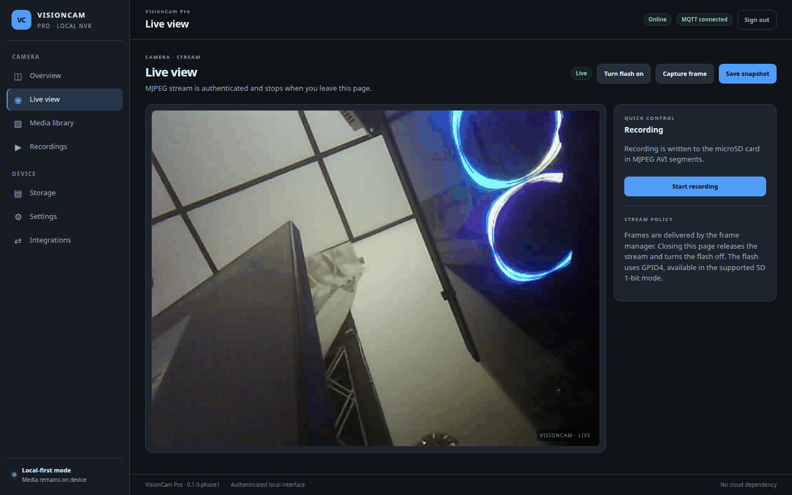
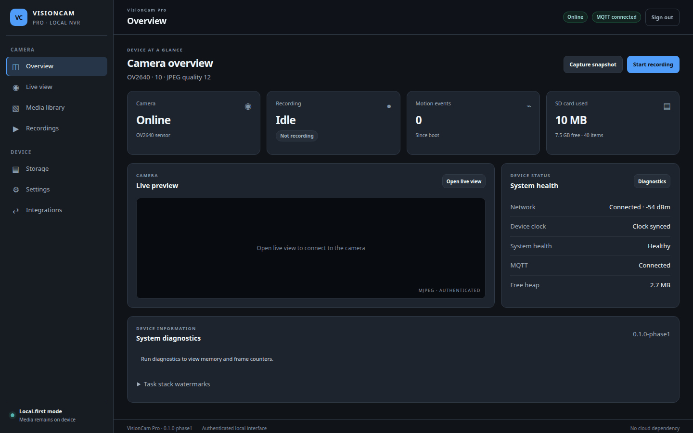
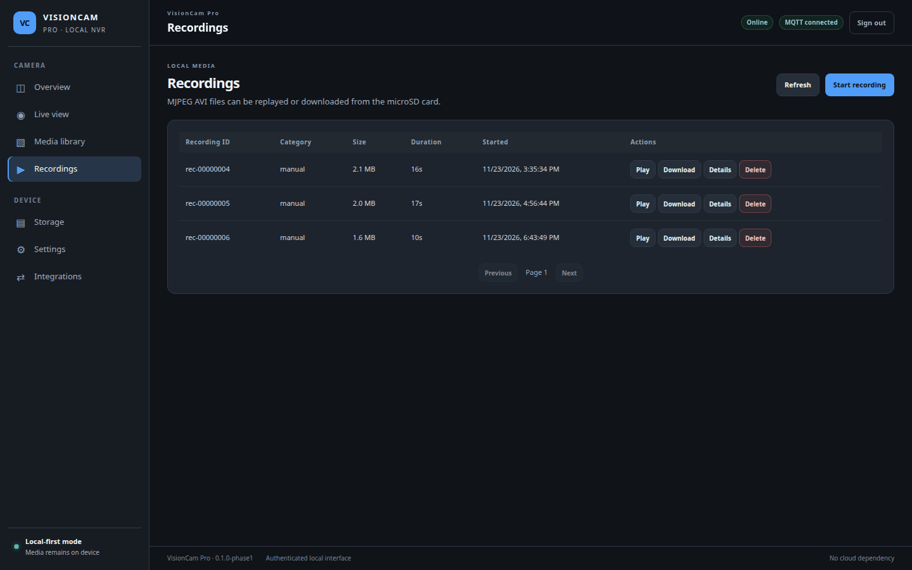
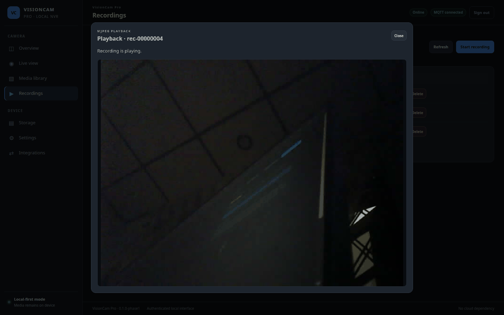
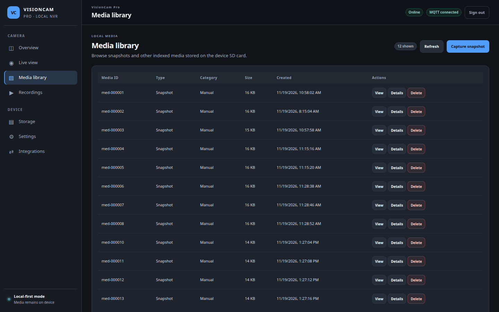
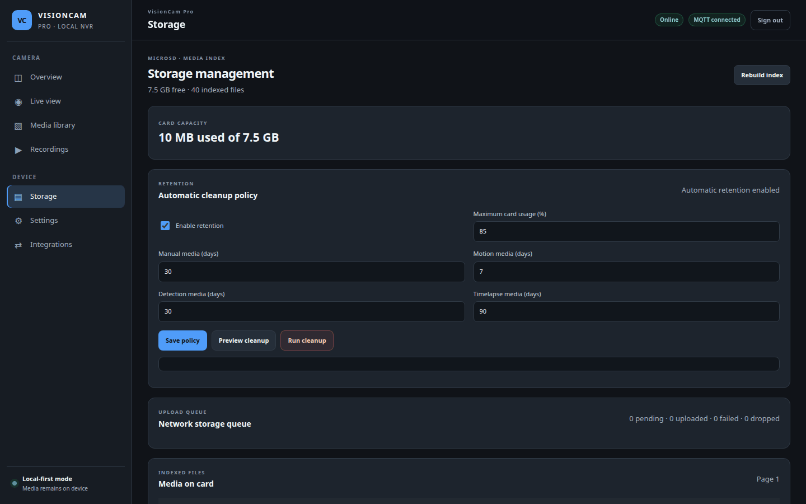
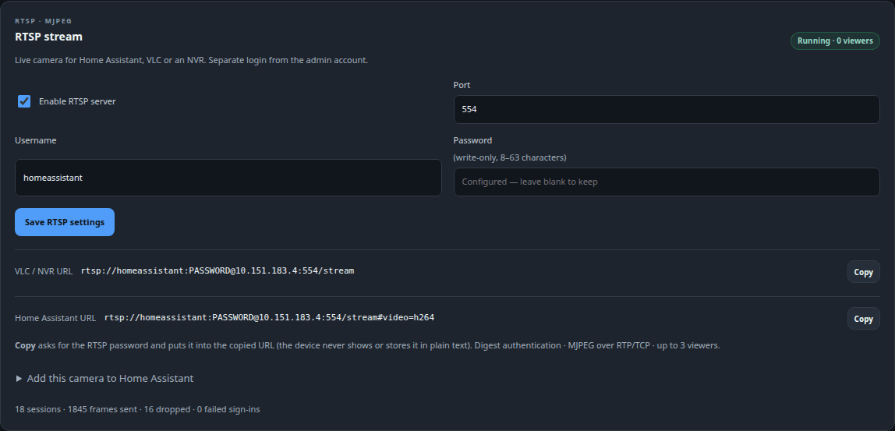
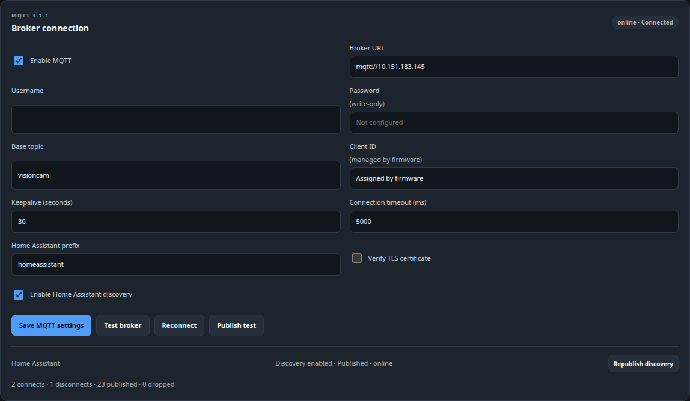
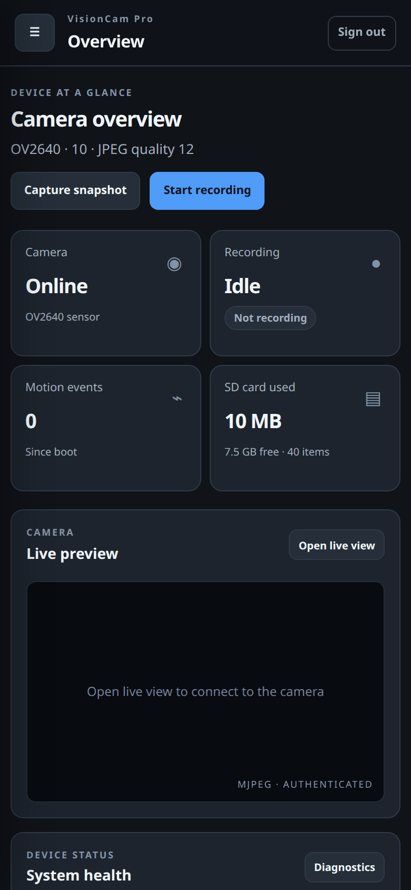
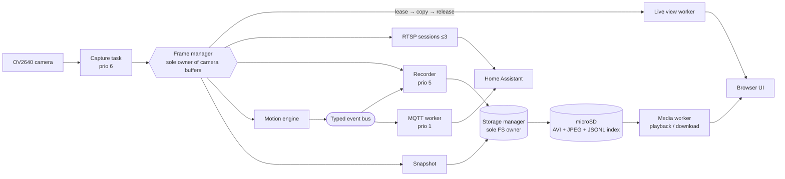

<div align="center">

# VisionCam Pro

**A private, local-first security camera firmware for the AI-Thinker ESP32-CAM**

Live view · RTSP · Snapshots · AVI recording · Motion detection · Home Assistant — no cloud required

[](https://github.com/charithmadhuranga/ESP-CAM/actions/workflows/ci.yml)


[](LICENSE)



</div>

> **The promise:** the camera keeps capturing, recording and managing its own
> media when the internet, the cloud, MQTT or your smart-home server are all
> unavailable. Everything it needs lives on the board and its microSD card.

---

## Contents

- [Highlights](#highlights)
- [Screenshots](#screenshots)
- [Hardware](#hardware)
- [Architecture](#architecture)
- [Build and flash guide](#build-and-flash-guide)
- [First-time setup](#first-time-setup)
- [Home Assistant](#home-assistant)
- [RTSP streaming](#rtsp-streaming)
- [HTTP API](#http-api)
- [Measured performance](#measured-performance)
- [Security model](#security-model)
- [Testing](#testing)
- [Project status and roadmap](#project-status-and-roadmap)
- [Repository layout](#repository-layout)
- [Documentation](#documentation)
- [Contributing](#contributing)
- [Licence and acknowledgements](#licence-and-acknowledgements)

---

## Highlights

| | Feature | Details |
|---|---|---|
| ◉ | **Live view** | Authenticated MJPEG stream in the browser, pushed by a dedicated worker so the UI stays responsive; flash LED control |
| ⇄ | **RTSP server** | MJPEG over RTP (RFC 2435) on TCP, Digest authentication with its own credential, up to 3 viewers — works with VLC, NVRs and Home Assistant |
| ▧ | **Snapshots** | On-demand JPEG capture saved to microSD under opaque media IDs |
| ▶ | **Recording** | Standard MJPEG **AVI** segments (header + one chunk per frame + `idx1` index) that open in VLC or any player; in-browser playback and download |
| ◎ | **Motion detection** | 96×96 grayscale block comparison with configurable thresholds; drives recording, snapshots and MQTT events |
| ⌂ | **Home Assistant** | MQTT discovery creates a device with 8 entities, including a *Take snapshot* button and a *Flash LED* switch that work both ways |
| ▤ | **Storage management** | Indexed media library, retention by age and an 85 % card cap, index rebuild |
| 🔒 | **Secure by default** | Salted PBKDF2 passwords, RAM-only sessions, CSRF protection, forced first-login password change, secrets never logged |
| ⚙ | **Easy onboarding** | Setup Wi-Fi access point, or provision Wi-Fi over the USB serial port with one line |
| ⚡ | **Built for the hardware** | Native ESP-IDF (no Arduino), bounded queues everywhere, a single owner of camera buffers, Wi-Fi/network buffers in PSRAM |

---

## Screenshots

<table>
  <tr>
    <td width="50%"><br><sub><b>Overview</b> — camera, recording, motion and storage at a glance</sub></td>
    <td width="50%"><br><sub><b>Recordings</b> — play, download or delete AVI segments</sub></td>
  </tr>
  <tr>
    <td><br><sub><b>Playback</b> — recordings streamed back at their recorded frame rate</sub></td>
    <td><br><sub><b>Media library</b> — snapshots indexed on the microSD card</sub></td>
  </tr>
  <tr>
    <td><br><sub><b>Storage</b> — retention policy, card usage and index rebuild</sub></td>
    <td><br><sub><b>RTSP</b> — separate login, ready-to-copy VLC and Home Assistant URLs</sub></td>
  </tr>
  <tr>
    <td><br><sub><b>MQTT</b> — broker connection and Home Assistant discovery</sub></td>
    <td align="center"><br><sub><b>Responsive</b> — the same UI on a phone</sub></td>
  </tr>
</table>

---

## Hardware

| Part | Notes |
|---|---|
| **AI-Thinker ESP32-CAM** | Original ESP32 (not S3), OV2640 sensor, 4 MB flash, PSRAM (4 MB mapped) |
| **ESP32-CAM-MB** adapter | USB-to-serial with auto-reset; used for flashing and the serial console |
| **microSD card** | FAT32; runs in SDMMC **1-bit** mode (frees the flash-LED pin GPIO4) |
| **5 V supply** | ≥ 1 A recommended; weak USB ports can cause brownouts during Wi-Fi bursts |

The pin map lives only in [`firmware/include/board_profile.h`](firmware/include/board_profile.h).
Board facts, the R1 baseline and the hardware validation log are in
[`docs/HARDWARE.md`](docs/HARDWARE.md).

**Flash layout** ([`partitions.csv`](partitions.csv)):

| Partition | Offset | Size | Purpose |
|---|---|---|---|
| `nvs` | `0x009000` | 92 KB | Settings and credentials (versioned) |
| `ota_0` | `0x020000` | 1.5 MB | App slot A (boots first) |
| `ota_1` | `0x1A0000` | 1.5 MB | App slot B (reserved for OTA) |
| `otadata` | `0x320000` | 8 KB | Boot-slot selection |
| `phy_init` | `0x322000` | 4 KB | RF calibration |
| `storage` | `0x323000` | 884 KB | Reserved (models / UI fallback) |

---

## Architecture



Design rules that keep a $10 board stable (full list in [`AGENTS.md`](AGENTS.md)):

- **One owner per resource.** Only the frame manager touches camera buffers; only the storage manager touches the filesystem.
- **Never block capture.** Every consumer gets a 2-deep drop-oldest queue — a slow browser, RTSP viewer or broker lowers *its own* frame rate, never the camera's.
- **Everything is bounded.** Queues, buffers, sessions and payloads have compile-time limits; large buffers live in PSRAM.
- **Degrade, don't crash.** MQTT, RTSP and network storage are optional; their failure never stops recording.
- **Opaque IDs, not paths.** Media APIs accept IDs; arbitrary filesystem paths are never exposed.

More detail: [`docs/ARCHITECTURE.md`](docs/ARCHITECTURE.md).

---

## Build and flash guide

### 1. Prerequisites

| Tool | Version | Install |
|---|---|---|
| PlatformIO Core | 6.x | `pipx install platformio` (or the VS Code extension) |
| Python | ≥ 3.10 | for PlatformIO and the asset embedder |
| Node.js | ≥ 20 | only to run the web UI tests |
| USB driver | CH340 (most ESP32-CAM-MB boards) | Linux: built in · Windows/macOS: vendor driver |

Everything else is pinned and downloaded by PlatformIO on the first build:
`platformio/espressif32@8.0.0` with **ESP-IDF 6.1.0**
(`framework-espidf@4.60100.0`). No Arduino core is used.

On **Linux**, give your user access to the serial port once:

```bash
sudo usermod -aG dialout "$USER"   # then log out and back in
```

### 2. Get the source

```bash
git clone https://github.com/charithmadhuranga/ESP-CAM.git
cd ESP-CAM
```

### 3. (Optional) Change the web UI

The UI in [`webui/src/`](webui/src/) is plain HTML/CSS/JS with no build step.
It is embedded into the firmware as gzip-compressed C arrays. If you edit it,
regenerate the arrays before building:

```bash
python3 tools/embed_web_assets/embed_web_assets.py webui/src firmware/src/web_assets
```

The embedder also stamps `index.html` with content-hashed asset URLs
(`/app.js?v=<hash>`), so browsers always load the new UI after a flash.

### 4. Build the firmware

```bash
pio run -e esp32cam
```

The first build downloads the toolchain (a few minutes). Expect roughly
`Flash: 82.6% (1.30 MB of 1.5 MB)` and `RAM: 28.9%`.

### 5. Flash

1. Seat the ESP32-CAM on the **ESP32-CAM-MB** adapter and connect USB.
2. Flash (the MB board's auto-reset puts the ESP32 into download mode):

   ```bash
   pio run -e esp32cam -t upload                          # auto-detects the port
   pio run -e esp32cam -t upload --upload-port /dev/ttyUSB0
   ```

3. Watch it boot:

   ```bash
   pio device monitor -b 115200
   ```

   A healthy boot logs lines like these, ending with either
   `AP mode: ssid=VisionCam-XXXXXX` (no Wi-Fi saved yet) or
   `GOT_IP <address>`:

   ```text
   vc_smoke: PSRAM: 8388608 bytes (8.0 MB)
   vc_smoke: CAMERA OK: pid=0x0026, attempts=1, warmup=3, jpeg=213675 B (1600x1200)
   vc_web: HTTP server on port 80, max_open_sockets=10, stack=8192 B
   vc_smoke: SD OK: width=1 bit, max 20000 kHz, self-test=pass
   vc_net: GOT_IP 192.168.x.y (rssi -46 dBm, connects=1)
   ```

<details>
<summary><b>Flashing with esptool instead of PlatformIO</b></summary>

After `pio run`, the images are in `.pio/build/esp32cam/`:

```bash
esptool.py --chip esp32 --port /dev/ttyUSB0 --baud 921600 write_flash \
  0x1000   .pio/build/esp32cam/bootloader.bin \
  0x8000   .pio/build/esp32cam/partitions.bin \
  0x320000 .pio/build/esp32cam/ota_data_initial.bin \
  0x20000  .pio/build/esp32cam/firmware.bin
```

`ota_data_initial.bin` is generated by the PlatformIO build. If it is missing,
leave that line out and erase `otadata` once, so the device boots `ota_0`:
`esptool.py --chip esp32 erase_region 0x320000 0x2000`.

</details>

<details>
<summary><b>Troubleshooting</b></summary>

| Symptom | Fix |
|---|---|
| `Failed to connect to ESP32: No serial data received` | Hold **IO0/BOOT** on the MB board, tap **RST**, release IO0, retry. Try another USB cable (data, not charge-only). |
| `Permission denied: '/dev/ttyUSB0'` | Add yourself to `dialout` (see prerequisites). |
| Brownout / reboot loop when Wi-Fi starts | Use a stronger 5 V supply or a powered hub. |
| `SD FAIL` in the boot log | Reseat the card; use FAT32. The camera keeps working without storage. |
| UI looks outdated after flashing | Reload the page once; asset URLs are content-hashed. |
| Boot hangs after an old partition layout | Erase once: `pio run -t erase`, then flash again. |

</details>

---

## First-time setup

1. **Join Wi-Fi**, either way:
   - **Setup access point:** with no saved network the camera broadcasts
     `VisionCam-XXXXXX` (passphrase `visioncam`). Join it and open
     `http://192.168.4.1` → *Settings → Connect camera to Wi-Fi*.
   - **Over USB serial:** at 115200 baud send one TAB-separated line. The
     camera saves it and reboots. The password is never echoed; replies only
     show lengths:

     ```text
     wifi<TAB>Your SSID<TAB>your-password
     ```

2. **Sign in** at `http://<camera-ip>/` with the factory login `admin` /
   `admin`. You must set a new password before anything else works.
3. **Optional:** set up MQTT and RTSP under **Integrations**.

---

## Home Assistant

### Sensors and controls (MQTT discovery)

1. Run an MQTT broker, e.g. Mosquitto, that Home Assistant also uses.
2. In VisionCam: **Integrations → MQTT**. Set the broker URI to your broker's
   **LAN IP** (on the camera, `localhost` means the camera itself), enable
   *Home Assistant discovery*, and save.
3. Home Assistant shows a **VisionCam Pro** device:

| Entity | Type | Notes |
|---|---|---|
| Motion | binary sensor | from the motion engine |
| Recording | binary sensor | |
| Camera · SD card | binary sensors | diagnostic |
| Storage used | sensor (%) | diagnostic |
| Wi-Fi signal | sensor (dBm) | diagnostic |
| **Take snapshot** | button | publishes `visioncam/<id>/cmd/snapshot` |
| **Flash LED** | switch | `visioncam/<id>/cmd/flash_led` `ON`/`OFF` |

Discovery is republished automatically when Home Assistant restarts.

### Live video (RTSP + go2rtc)

1. In VisionCam: **Integrations → RTSP stream**. Enable it and set a username
   and password (a separate login, not the admin account).
2. Press **Copy** next to *Home Assistant URL* and type the RTSP password. The
   dialog shows the full URL to copy.
3. Home Assistant → *Settings → Devices & services → Add integration →*
   **Generic Camera**:
   - *Stream source:* the copied URL, which ends in `#video=h264`
   - *RTSP transport:* **TCP** · *Authentication:* **digest**
   - *Still image URL:* leave empty

The camera sends MJPEG, and browsers cannot play MJPEG over WebRTC.
`#video=h264` makes Home Assistant's built-in **go2rtc** transcode it to H.264
on the HA host. Keep *Preload camera stream* off and remove leftover Generic
Camera entries, so HA uses a single connection.

---

## RTSP streaming

```text
rtsp://USER:PASSWORD@<camera-ip>:554/stream
```

- **VLC:** *Media → Open Network Stream*, paste the URL.
- **ffmpeg / ffplay:** `ffplay -rtsp_transport tcp "rtsp://USER:PASSWORD@<camera-ip>:554/stream"`
- **Codec:** MJPEG (payload type 26) over RTP interleaved on TCP. UDP
  requests get `461`, and clients fall back to TCP automatically.
- **Limits:** 4 connections, 3 of which may stream; a 4th gets `453`. Idle
  probes are closed after 15 s.
- **Credentials:** Digest only (no Basic); the device stores just the HA1
  hash. Characters that break URLs (`# / ? %`, space) must be
  percent-encoded; the UI's Copy dialog does this for you.

---

## HTTP API

All endpoints except sign-in and static assets require a session.
State-changing requests also need the `X-CSRF-Token` header. Responses use a
versioned `{ok, data, error, request_id}` envelope.

| Area | Endpoints |
|---|---|
| Auth | `POST /auth/login` · `POST /auth/logout` · `GET /auth/session` · `POST /auth/complete-first-login` · `POST /auth/change-password` |
| Device | `GET /device` · `GET /status` · `GET /health` · `GET /metrics` · `POST /device/restart` · `POST /wifi/config` |
| Camera | `GET /camera/status` · `GET/PUT /camera/settings` · `GET /camera/stream` · `POST /camera/capture` · `POST /camera/flash` |
| Snapshots | `GET /snapshot` · `POST /snapshot` |
| Recording | `GET /recording/status` · `GET/PUT /recording/config` · `POST /recording/start` · `POST /recording/stop` |
| Recordings | `GET /recordings` (list, `?action=metadata\|download\|play&id=`) · `DELETE /recordings?id=` |
| Motion | `GET /motion/status` · `GET/PUT /motion/config` |
| Storage | `GET/POST/PUT/DELETE /storage` (media list, retention, index rebuild) |
| Integrations | `GET/PUT /integrations/mqtt` (+ `/test`, `/reconnect`, `/test-publish`) · `GET /integrations/home-assistant/status` · `POST /integrations/home-assistant/discovery` · `GET/PUT /integrations/rtsp` · `GET/PUT /integrations/network-storage` (+ `/queue`, `/test`) |

---

## Measured performance

Measured on the owner's board, a SanDisk 8 GB card, over a phone hotspot
with 140–290 ms RTT. Full logs are in [`docs/HARDWARE.md`](docs/HARDWARE.md)
and [`docs/TEST_PLAN.md`](docs/TEST_PLAN.md).

| Metric | Result |
|---|---|
| Live view (browser, 640×480) | ~10 fps; 8 parallel API calls still served |
| RTSP, single viewer | 593 frames / 60 s (≈ 9.9 fps), 0 decode errors |
| RTSP + browser live view together | 12.4 fps + 11.7 fps |
| Recording (VGA) | 200 frames / 16 s (12.5 fps); ffprobe/ffmpeg decode with 0 errors |
| Recording download | 2.3 MB at 80–143 KB/s (link-limited), byte-identical repeats |
| Firmware size | 1.30 MB = 82.6 % of a 1.5 MB app slot |
| Internal heap free | ≈ 34 KB idle, ≈ 23 KB with three RTSP viewers |

---

## Security model

- **Passwords** are stored as salted **PBKDF2-HMAC-SHA256**. RTSP uses its own
  Digest credential, stored only as HA1. Neither is ever logged or returned
  by the API.
- **Sessions** live only in RAM, in an `HttpOnly` cookie; a reboot signs
  everyone out. Every state change also needs a CSRF token
  (double-submit).
- **Forced first-login** password change; `admin`/`admin` cannot be kept.
- **No credentials in URLs or browser storage.** Wi-Fi, MQTT and RTSP
  passwords are write-only in the UI.
- **Serial provisioning** prints lengths only.
- **Keep it on your LAN.** VisionCam is designed to be private by default and
  must not be exposed directly to the internet.

---

## Testing

| Suite | Command | What it covers |
|---|---|---|
| Web UI unit tests | `cd webui && npm ci && npm run check` | Syntax check, API-client contract |
| Web UI end-to-end | `cd webui && npx playwright install chromium && npm run test:e2e` | 14 Playwright tests against a mock device: auth, live view, recording, playback, RTSP card and copy dialog, confirmation dialogs, Wi-Fi setup |
| AVI writer (host) | `test/host/run_avi_test.sh` | Builds the AVI writer on the PC and validates its output with **ffprobe/ffmpeg** |
| Firmware build | `pio run -e esp32cam` | Full ESP-IDF build |
| Hardware | [`docs/TEST_PLAN.md`](docs/TEST_PLAN.md) | Per-phase rows marked `HW PASS`, `RUN PASS` or `UNVERIFIED` |

GitHub Actions runs the web UI, AVI host-test and firmware build jobs on every
push ([`.github/workflows/ci.yml`](.github/workflows/ci.yml)).

---

## Project status and roadmap

| Phase | Scope | Status |
|---|---|---|
| 0 | Platform baseline: PSRAM, camera, SD 1-bit, partitions | ✅ Done, hardware-verified |
| 1 | Camera manager, frame manager, auth, embedded UI, live view | ✅ Done, hardware-verified |
| 2 | Storage manager, snapshots, media index, retention | ✅ Done, hardware-verified |
| 3 | AVI recording, playback, download | ✅ Done, hardware-verified · ⏳ crash recovery of interrupted segments is still a stub |
| 4 | Motion engine and events | ✅ Done, hardware-verified |
| 5 | Timelapse | 🧩 Implemented, **compiled out** of the current build |
| 6 | AI framework (external / TFLite Micro) | 🧩 Implemented, **compiled out** of the current build |
| 7 | MQTT + Home Assistant discovery and commands | ✅ Done, verified with Mosquitto + Home Assistant 2026.11 |
| D7 | RTSP server (owner decision) | ✅ Done, hardware-verified; HA live view via go2rtc |
| 8 | Network storage (HTTP upload queue) | 🧪 Implemented, hardware validation pending |
| 9 | Hardening and release (24 h soak, OTA, power-loss recovery) | ⏳ Planned |

Phase plans and gates: [`.opencode/plans/README.md`](.opencode/plans/README.md).

**Known limitations**

- MJPEG only. The ESP32 has no H.264 encoder, so H.264 consumers must
  transcode (Home Assistant's go2rtc does this automatically).
- Over a weak Wi-Fi link, several simultaneous viewers share the bandwidth
  and each gets a lower frame rate.
- There is no OTA update yet. The partition table keeps two app slots ready
  for it.

---

## Repository layout

| Path | Contents |
|---|---|
| [`firmware/src/`](firmware/src/) | ESP-IDF application: `camera/`, `frame/`, `recording/`, `storage/`, `motion/`, `rtsp/`, `mqtt/`, `web/`, `network/`, `auth/`, `core/` |
| [`firmware/include/`](firmware/include/) | Public headers, `board_profile.h` (pins), `tasks.h` (priorities and stacks) |
| [`webui/`](webui/) | Embedded web UI (`src/`) with unit and Playwright tests (`tests/`) |
| [`tools/`](tools/) | Asset embedder, SD formatter, NVS helpers |
| [`test/host/`](test/host/) | Host-side tests (AVI writer) |
| [`docs/`](docs/) | Architecture, hardware log, test plan, reference analysis, ADRs, screenshots |
| [`tutorial/`](tutorial/) | Video guide and narration scripts for the tutorial series |
| [`SPEC.md`](SPEC.md) · [`DESIGN.md`](DESIGN.md) | Normative specification · UI design system |
| [`AGENTS.md`](AGENTS.md) | Mandatory engineering rules for contributors and coding agents |

---

## Documentation

- [Architecture](docs/ARCHITECTURE.md) — modules, tasks, data flow
- [Hardware](docs/HARDWARE.md) — board facts, baselines, serial Wi-Fi, RTSP and Home Assistant setup, validation log
- [Test plan](docs/TEST_PLAN.md) — every acceptance row with its evidence
- [Reference analysis](docs/REFERENCE_ANALYSIS.md) — adopt/adapt/reject decisions
- [Toolchain ADR](docs/adr/0001-toolchain.md) — pinned versions and why
- [Changelog](CHANGELOG.md)

---

## Contributing

Read [`AGENTS.md`](AGENTS.md) and [`SPEC.md`](SPEC.md) first. In short:

- Work one phase at a time and keep its gate green.
- Every queue must be bounded and every return code checked.
- Never claim a test passed unless you ran it.
- Update the docs, `docs/TEST_PLAN.md` and `CHANGELOG.md` with each change.
- After editing `webui/src/`, run the asset embedder (step 3) and both web UI
  test suites before opening a PR.

---

## Licence and acknowledgements

VisionCam Pro is released under the **[MIT License](LICENSE)** —
© 2026 Proto Vision Lab.

Third-party components keep their own licences:

- [espressif/esp32-camera](https://github.com/espressif/esp32-camera) (Apache-2.0) — the camera driver, pinned as a managed component.
- [ESP-IDF](https://github.com/espressif/esp-idf) and [esp-mqtt](https://github.com/espressif/esp-mqtt) by Espressif.
- [s60sc/ESP32-CAM_MJPEG2SD](https://github.com/s60sc/ESP32-CAM_MJPEG2SD) (AGPL-3.0) served as a **behavioural reference only**. Under owner decision D1, VisionCam is a clean-room implementation and contains no R1 code.
